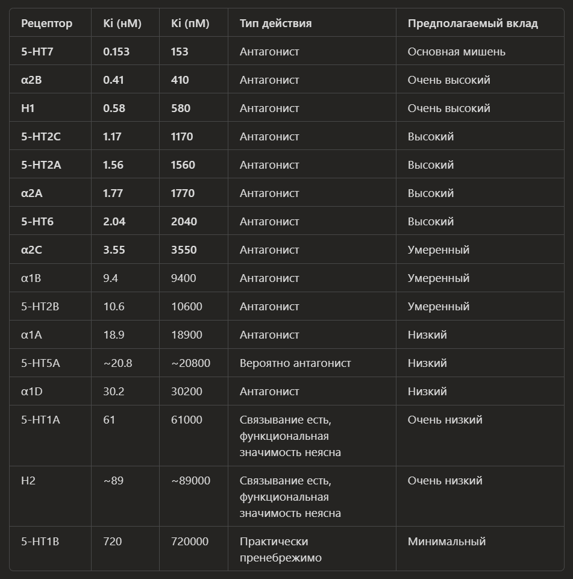

# [АВИАНДР | Маритупирдин (Maritupirdine)](https://aviandr.ru/)

**ГРЛС:**

- [Маритупирдин](https://grls.pharm-portal.ru/grls/a85eee9f-afab-4b29-bf8a-ba49fd27339a#summary)
- [2,8-диметил-5-(2-фенилэтил)-2,3,4,5-тетрагидро-1H-пиридо[4,3-b]индола гидрохлорид](https://grls.pharm-portal.ru/grls/26afe55c-02b5-41c6-a53b-7a09eb619ef1#summary)

**rlsnet:**

- [drug](https://www.rlsnet.ru/drugs/aviandr-89501)
- [active-substance](https://www.rlsnet.ru/active-substance/maritupirdin-4424)

## Коды и индексы

**АТХ:** `N05BX` (Другие анксиолитики)

**МКБ-10:**

- `F41.1` Генерализованное тревожное расстройство
- `F41.9` Тревожное расстройство неуточненное
- `F43` Реакция на тяжелый стресс и нарушения адаптации
- `F43.9` Реакция на тяжелый стресс неуточненная

- `R45.7` Состояние эмоционального шока и стресса неуточненное
- `Z60.0` Проблемы, связанные с адаптацией к изменению образа жизни

## Фармакологический интерфейс

<!-- подробнее о профиле рецепторной аффинности, типах и карманах связывания самого действующего вещества и его метаболитов! -->

---

| Рецептор | Ki (нМ) | Ki (пМ) | Активность | Значимость |
| -------- | ------: | ------: | ---------- | ---------- |
| 5-HT7 | 0.153 | 153 | Антагонист | ★★★★★ |
| α2B | 0.41 | 410 | Антагонист | ★★★★★ |
| H1 | 0.58 | 580 | Антагонист | ★★★★★ |
| 5-HT2C | 1.17 | 1170 | Антагонист | ★★★★☆ |
| 5-HT2A | 1.56 | 1560 | Антагонист | ★★★★☆ |
| α2A | 1.77 | 1770 | Антагонист | ★★★★☆ |
| 5-HT6 | 2.04 | 2040 | Антагонист | ★★★★☆ |
| α2C | 3.55 | 3550 | Антагонист | ★★★☆☆ |
| α1B | 9.4 | 9400 | Антагонист | ★★☆☆☆ |
| 5-HT2B | 10.6 | 10600 | Антагонист | ★★☆☆☆ |
| α1A | 18.9 | 18900 | Антагонист | ★☆☆☆☆ |
| 5-HT5A | ~20.8 | ~20800 | Вероятно антагонист | ★☆☆☆☆ |
| α1D | 30.2 | 30200 | Антагонист | ★☆☆☆☆ |
| 5-HT1A | 61 | 61000 | Слабое связывание | ★☆☆☆☆ |
| H2 | ~89 | ~89000 | Слабое связывание | ★☆☆☆☆ |
| 5-HT1B | 720 | 720000 | Практически незначимо | ☆☆☆☆☆ |

---

| Рецептор | Во сколько раз слабее 5-HT7 |
| -------- | --------------------------: |
| 5-HT7 | 1× |
| α2B | 2.68× |
| H1 | 3.79× |
| 5-HT2C | 7.65× |
| 5-HT2A | 10.20× |
| α2A | 11.57× |
| 5-HT6 | 13.33× |
| α2C | 23.20× |
| α1B | 61.40× |
| 5-HT2B | 69.30× |
| α1A | 123.50× |
| α1D | 197.40× |
| 5-HT1A | 399× |
| H2 | 582× |
| 5-HT1B | 4705× |

---

Основной якорь, предположительно: `Asp3.32`

| Рецептор | Семейство | Карман |
| -------- | --------- | ------- |
| 5-HT7 | GPCR-A | Ортосайтовый |
| 5-HT6 | GPCR-A | Ортосайтовый |
| 5-HT2A | GPCR-A | Ортосайтовый |
| 5-HT2C | GPCR-A | Ортосайтовый |
| H1 | GPCR-A | Антигистаминовый карман |
| α2A | GPCR-A | Адренергический карман |
| α2B | GPCR-A | Адренергический карман |
| α2C | GPCR-A | Адренергический карман |
| α1A/B/D | GPCR-A | Адренергический карман |

---

### π-π взаимодействия

Участвуют ароматические остатки:

- Phe
- Tyr
- Trp

Стабилизируют гамма-карболиновое ядро.

---

### Гидрофобное упаковывание

Фенэтильный хвост занимает липофильную полость рецептора:

- TM3
- TM5
- TM6

---

### Системная нейрофармакология

Основной вклад:

5-HT7 блокада
→ снижение патологической сетевой возбудимости
→ снижение руминации
→ изменение динамики DMN

α2 блокада
→ усиление норадренергической передачи
→ повышение кортикального контроля

H1 блокада
→ анксиолитический компонент
→ умеренная седативность

5-HT2A / 5-HT2C блокада
→ снижение эмоциональной гиперреактивности
→ антидепрессивный вклад

5-HT6 блокада
→ когнитивно-модулирующий компонент

---

### Метаболиты

Опубликованных полных таблиц рецепторного связывания для них в открытой литературе нет

---

Для врача: [Авиандр ОХЛП от 16.07.2026](https://disk.360.yandex.ru/i/n-l5OQc0Fbsojw)
Для пациента: [ГРЛС](./AVIANDR__Patient_information_GRLS.pdf) | [Официальный сайт](./AVIANDR__Patient_information.pdf)
