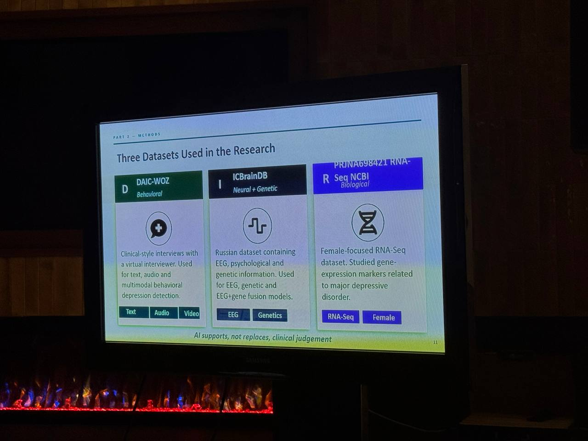
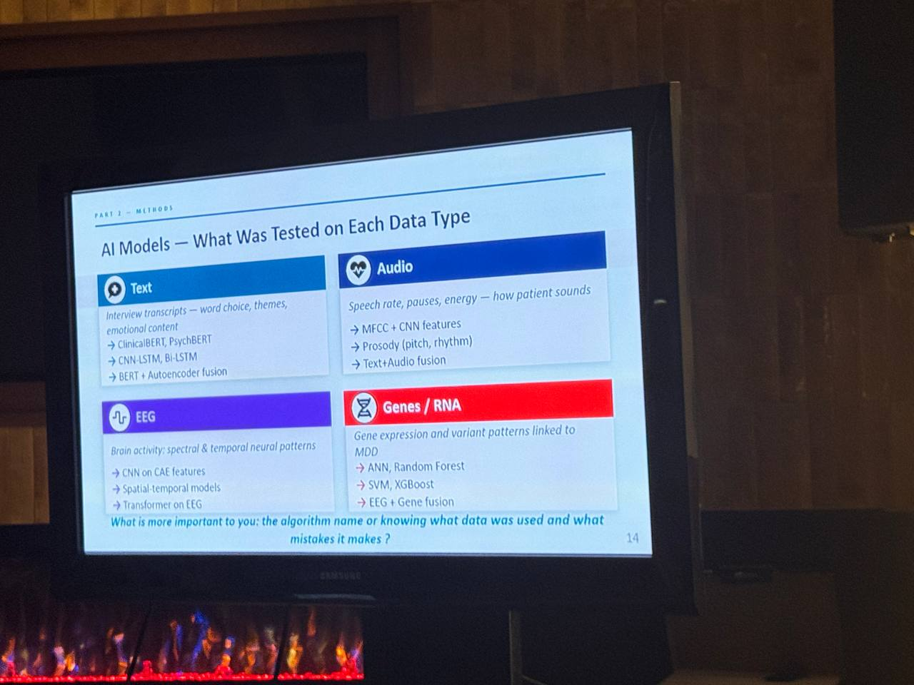

# Первичные идеи

## Роман

Я скорее разработчик с глубоким погружением в медицинские исследования и подходы, но не врач и не имею официального мед. образования, также нет и опыта потокового взаимодействия с клиниками и пациентам, что как будто бы очень полезно при решении кейса.

Но представления по продукту есть примерные: анализ речи пациента как звуковой временной ряд и текст с выделением ключевых признаков. Возможно какие-то упрощённые тесты по психометрическим шкалам, если будут данные нейровизуализации или какие-то биомаркеры — их тоже было бы круто добавить в модуль диагностики.
Также как я понял — отдельный процесс и модуль нужен по ведению пациентов и их кластеризация на подгруппы состояний и виды депрессий/тревожностей.

---

Т.к. организаторы ещё не выложили ТЗ — пока не очень понятно насколько нужен будет модуль, связанный с фармакологическими интервенциями и ведением статистики по принимаемым лекарствам (если понадобится, то можно заиспользовать в нем [API от "РЛС: Клинический фармаколог"](https://rls-aurora.ru/Help)). Но если рассматривать эту историю в качестве продукта, то такое было бы очень полезно. Основываясь на данных мед.визуализации, доступных биомаркерах, генетике пациентов, их речи, анамнезе и отчетах о принимаемых препаратах (не только в рамках психиатрии), а также их действии и современных исследованиях строить цифровой профиль и подсказывать наиболее релевантные вмешательства врачу для финального выбора стратегии лечения.

В любом случае сделать все и сразу, вероятно, не получится за время проведения соревнования. Нужно будет фокусироваться на чем-то основном.

---

По поводу анализа речи, интонаций, микропауз и просодий — тут можно поискать ресерчи и какие-то готовые модели первым делом, именно для классификации/кластеризации и извлечения признаков депрессий и в целом психоэмоционального состояния

Знаю, что Даша работает над схожим проектом, возможно есть некоторые пересечения в используемых технологиях и уже готовые пайплайны для разбора и адаптации.

---

Надо глубже понять, как реально происходит приём пациентов, какие могут быть проблемы и краевые случаи.
Опыт Марии здесь очень ценен!

Например, пациент может быть полностью немым, но с сохранной возможностью письма и наоборот. При беседе может специально вводить в заблуждение или не знать / не мочь правильно описать своё состояние по разным причинам.
Может забыть упомянуть о некоторых уже принимаемых лекарствах или симптомах.

Хорошо, если данные уже какие-то есть и это не первый приём. В случае первичной консультации надо правильно подойти к задаче "холодного старта" — где взять недостающие данные и из какого состояния системы строить прогнозы и рекомендации.

Результаты биологических лаб. тестов также могут быть неточны. Не у всех пациентов есть данные о своей генетике и далеко не всегда их возможно получить (это уже в сторону персонализации куда-то, сейчас, насколько я понимаю, ген. тестирование рутинно не используется, только при долгом подборе препаратов при первых неудачных попытках)
В целом медикаментозная терапия может и не понадобиться в более простых случаях, тогда уже нужен подбор правильного метода только психотерапии

Пока выглядит как большая кроличья нора, в которую можно долго закапываться.

---

[Нейрокампус: лекторий. Шмилович Андрей Аркадьевич «Происхождение и терапия депрессий: взгляд из будущего»](https://vkvideo.ru/video-216180485_456239186)

## Мария

Доклад коллеги с Индии: AI-assisted depression detection: How multimodal AI can support early screening

> Но как психиатр буду ратовать именно за дифференциальную диагностику. Потому что, что шизу, что депрессию можно клинически поставить.

## Дарья

Сделана проработка концепции.
Посмотрела аналоги среди мобилок и web- платформ. Сравнила функционал и посмотрела, что можем внедрить у себя и в какой последовательности.

Смотрела с точки зрения реализации и функционала не углубляясь в психологию.

[Концепция продукта и проработка](concept01.pdf)

## Полина

Есть такое приложение `rejoyn`, которое предоставляет дополнительную помощь пациенту (дополнительное рецептурное лечение), можно его внедрить к нам:

[MindPath_Therapeutics_architecture](concept02.pdf)

Еще я подумала о том, что депрессивные состояния в целом очень подавляют деятельность. У меня было нечто похожее недавно, и я не хотела делать ничего вообще. Даже маленькие действия сложно делать, поэтому вполне вероятно, что пациент не будет вести дневник и выполнять всякие задачи, поэтому можно немного адаптироваться под это.

Спросила у клода про возможные пути. Он выдал:

1. Снизить цену действия до минимума

- Микро-отметка вместо дневника: одно касание (смайлик или шкала из 5 значений) за 5 секунд. Текст необязателен.
- Короткие сессии, 5-10 минут, с возможностью остановиться и продолжить позже.
- Всё предзаполнено: вопросы по умолчанию, быстрые ответы-кнопки, голосовой ввод вместо печати.
- Один экран, одно действие. Никаких меню и выбора.
