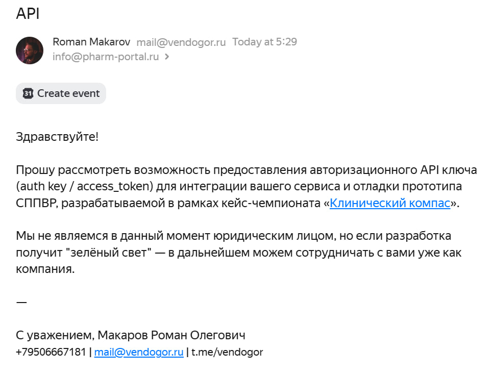
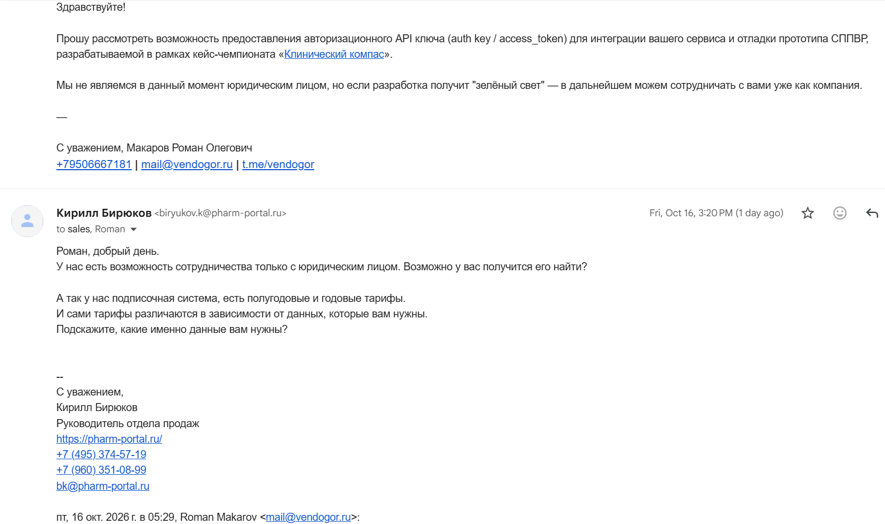

# Прочие идеи и замечания

## Роман

Изучаю доки, наткнулся на вот этот пункт про ГРЛС.

Если захотим для пациента и врача сделать условную кнопку по скачиванию инструкций, то возможно придётся написать [им](https://pro.pharm-portal.ru/api-integration) и запросить auth key для [API](https://api.pharm-portal.ru/docs).

Ну или парсить сам сайт через beautifulsoup (если python) в обход капчи как-то

— — —

ГРЛС: [Маритупирдин](https://grls.pharm-portal.ru/grls/a85eee9f-afab-4b29-bf8a-ba49fd27339a#summary) / [2,8-диметил-5-(2-фенилэтил)-2,3,4,5-тетрагидро-1H-пиридо[4,3-b]индола гидрохлорид](https://grls.pharm-portal.ru/grls/26afe55c-02b5-41c6-a53b-7a09eb619ef1#summary)
Как минимум для него точно нужна [инструкция](../drugs/AVIANDR/AVIANDR__Patient_information_GRLS.pdf)

upd.: есть [оф. сайт](https://aviandr.ru/), с которого можно тоже что-то парсить, там же можно скачать инструкции для врача и пациента отдельно (для пациента там доп. пункты есть и [файл](../drugs/AVIANDR/AVIANDR__Patient_information.pdf) выглядит причесаннее относительно ГРЛС).

Другие реестры лекарств мы НЕ можем использовать в ПО законодательно, я так понимаю, даже если они проще для интеграции и в них больше информации.

---

Ответ:

