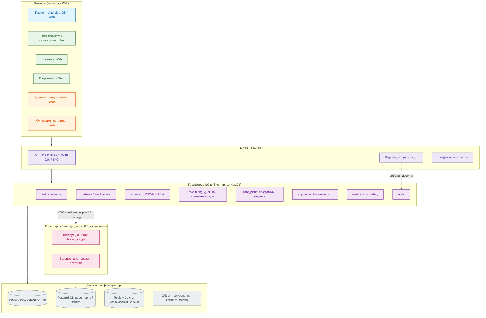
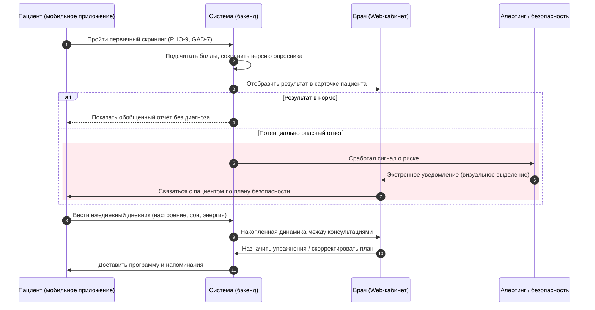
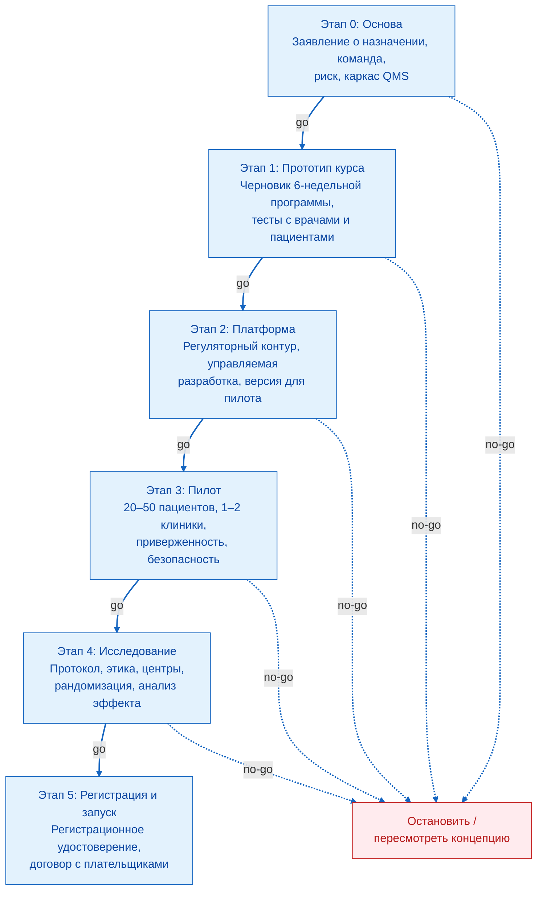
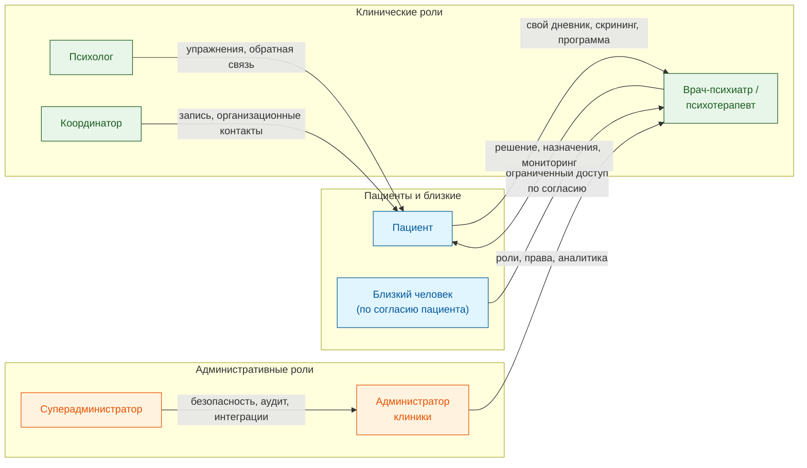
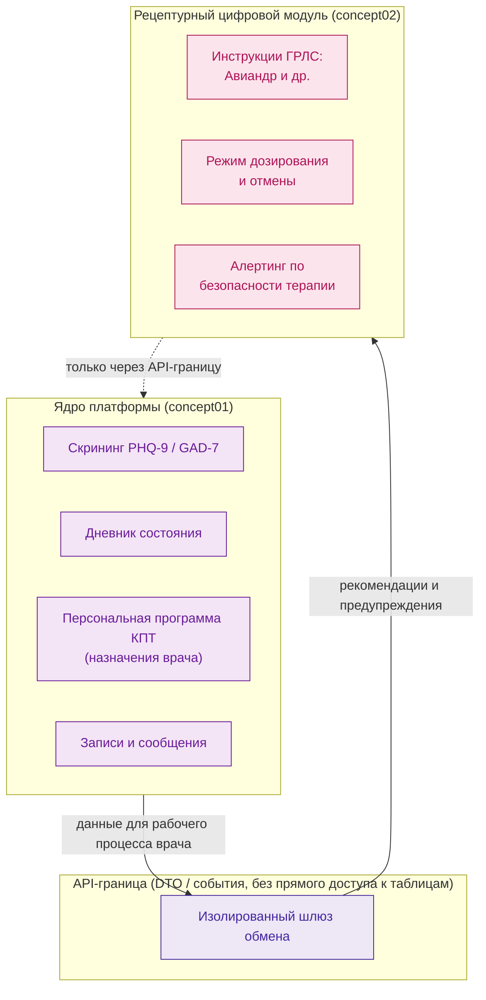

# Диаграммы системы «Клинический компас» (Mermaid)

Ниже приведены диаграммы, дополняющие техническое задание v1.0.  
Их можно отрендерить в любом редакторе с поддержкой Mermaid (VS Code, Notion, Obsidian, GitLab/GitHub и др.).

---

## 1. Высокоуровневая архитектура

---

## 2. Последовательность скрининга и уведомления врача

---

## 3. Дорожная карта с условными переходами (go / no-go)

---

## 4. Роли и права доступа

---

## 5. Разделение контуров (платформа vs рецептурный модуль)

